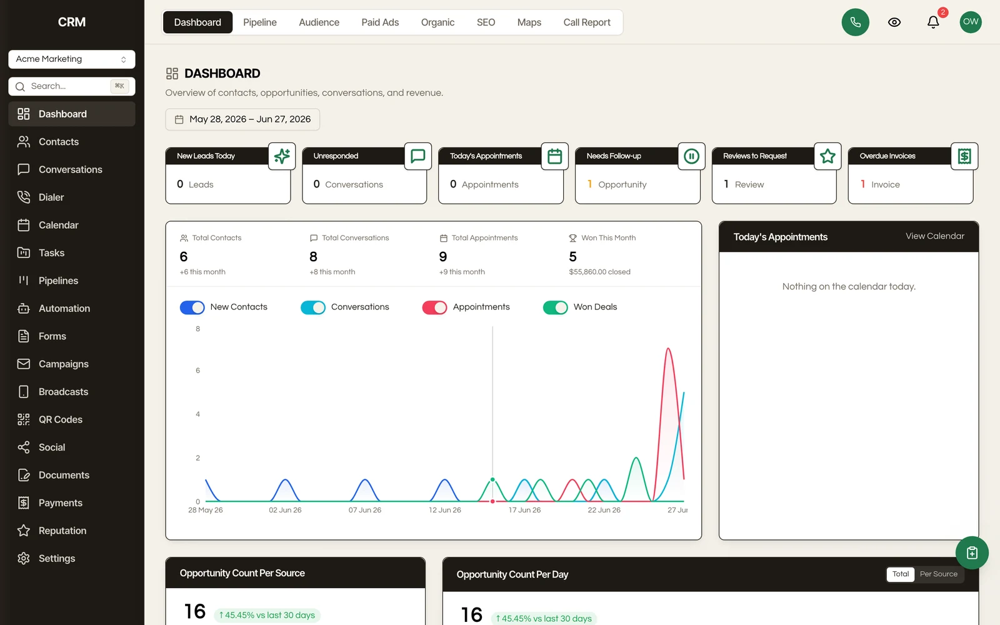
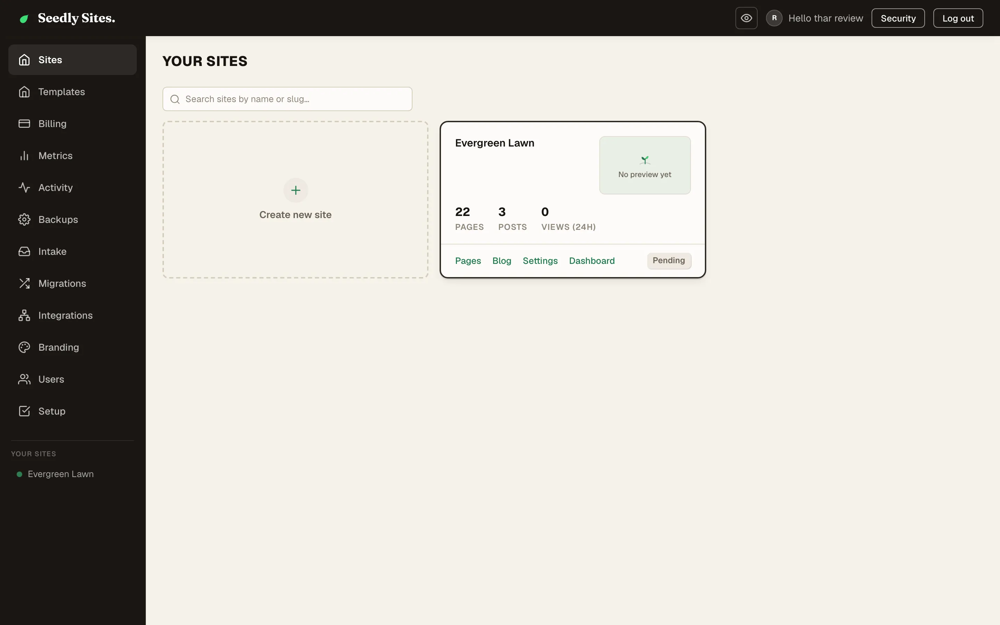
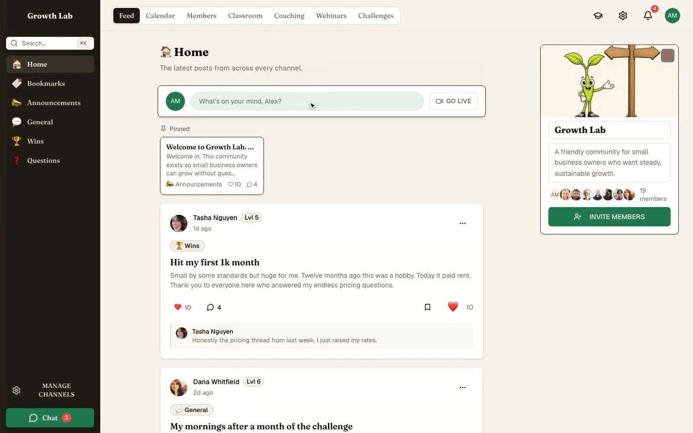

<h1 align="center">Seedly.</h1>

  <strong>Good software. Yours to grow.</strong> 
  Commercial source code for agencies and operators who want to run software under their own brand.

  
  
  
  

  

## Try a live demo

Pick CRM, Sites, or Communities on the [Seedly demo page](https://goseedly.com/demo) to request your access link. Try a workflow you'd actually run before you choose a codebase.

| 🌱 CRM | 🦔 Sites | 🐝 Communities |
| :---: | :---: | :---: |
|  |  |  |
| Open a contact, move a deal, and inspect a workflow. | Open a sample site and work through a page edit. | Browse the feed, open a lesson, and preview membership settings. |
| [Explore CRM](https://goseedly.com/products/crm) | [Explore Sites](https://goseedly.com/products/sites) | [Explore Communities](https://goseedly.com/products/communities) |

## Build your stack

Start with the part of your business you want to take more control over. Each Seedly purchase includes the relevant codebase and setup materials under the [Seedly commercial software license](https://goseedly.com/license). You deploy it in your accounts and cover your hosting and connected services.

| Codebase | What you can run | Start here |
| --- | --- | --- |
| **Seedly CRM** | Contacts, pipelines, booking, shared inbox, forms, and automation for client work. | [Product](https://goseedly.com/products/crm) · [Setup guide](https://help.goseedly.com/crm/setup) |
| **Seedly Sites** | A branded client website and funnel builder with a CMS and visual editing. | [Product](https://goseedly.com/products/sites) · [Setup guide](https://help.goseedly.com/sites/getting-started) |
| **Seedly Communities** | A branded community with discussions, courses, memberships, and events. | [Product](https://goseedly.com/products/communities) · [Setup guide](https://help.goseedly.com/communities/getting-started) |
| **Seedly Dispatch** | Job scheduling and field operations connected to Seedly CRM. Requires CRM. | [Product](https://goseedly.com/products/dispatch) · [Docs](https://help.goseedly.com/dispatch) |
| **Seedly Linkd** | A guided link for collecting access to clients' marketing accounts. | [Product](https://goseedly.com/products/linkd) · [Docs](https://help.goseedly.com/linkd) |
| **Seedly Tasks** | Project boards, time tracking, and a client portal. | [Product](https://goseedly.com/products/tasks) · [Docs](https://help.goseedly.com/tasks) |

**Founders Club** includes Dispatch, Linkd, and access to the private Founders Club space for owners of CRM, Sites, and Communities. Purchases can be made separately. [Check your stack](https://goseedly.com/complete-your-stack).

## Get set up

1. **Get your code.** [Choose a codebase](https://goseedly.com/shop) or sign in to [My software](https://goseedly.com/account) to download a product you already own.
2. **Follow the product guide.** Start with the [Help Center](https://help.goseedly.com/) and the guide included in the download. Review [how Seedly works](https://goseedly.com/how-it-works) for setup companions and update workflows.
3. **Test under your brand.** Run your key workflow in a test deployment before inviting clients or members. Connect the providers you need, verify backups, and set aside time to review [release notes](https://goseedly.com/changelog) before updating.

## Resources for builders

| Resource | What you'll find |
| --- | --- |
| [Developer reference](https://developers.goseedly.com/crm/api) | REST API operations, authentication, and request examples for your CRM deployment. |
| [Webhooks](https://developers.goseedly.com/crm/webhooks) | Events and payloads for integrations you build. |
| [Learning Center](https://goseedly.com/learning/software-development-tutorials-for-beginners) | Free lessons on software, Git, and working with code. |
| [GoHighLevel export tool](https://goseedly.com/blog/tools/gohighlevel-data-export) | A data export tool with a standalone script you can download and run locally. |
| [GoHighLevel to Seedly migration guide](https://goseedly.com/blog/how-to-migrate-from-gohighlevel-to-seedly) | What to inventory, what to move, and what to test before cutting over. |
| [Go High Level alternatives](guides/go-high-level-alternatives.md) | A comparison of 14 open-source projects and a guide to choosing what to replace. |

**Free downloads** · [Comparison scorecard (CSV)](downloads/comparison-scorecard.csv?raw=true) · [Migration inventory (CSV)](downloads/migration-inventory.csv?raw=true) · [Migration checklist (Markdown)](downloads/migration-checklist.md?raw=true)

## Meet the community

- **Join the Seedly Owners Community.** Ask about setup, share something you built, or compare notes with other operators in the [Facebook group](https://www.facebook.com/groups/seedly.brand).
- **Build for Seedly customers.** Interested in becoming a Seedly Marketplace vendor? [Contact Seedly](mailto:support@goseedly.com?subject=Seedly%20Marketplace%20vendor%20inquiry) with what you're building, the Seedly codebase it works with, and a demo link.
- **Make this hub better.** [See how to contribute](CONTRIBUTING.md) with a correction, new resource, or open-source project for the comparison guide.

This repository hosts Seedly's public guides and downloads. The product codebases are distributed separately through your Seedly account under the <a href="https://goseedly.com/license">commercial license</a>.
